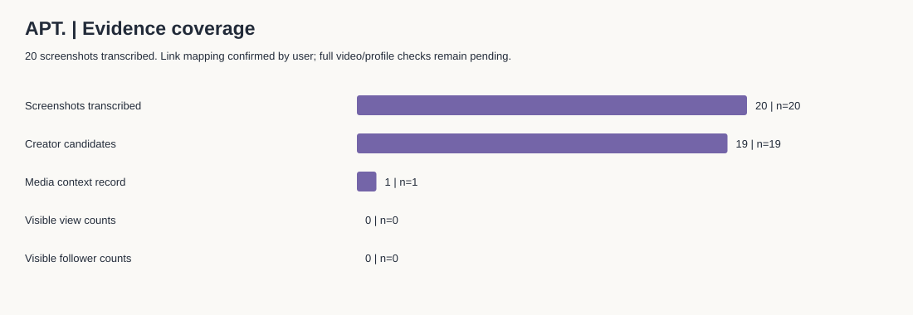

# APT. TikTok Marketing Portfolio
## 从舞蹈挑战到主题歌单发现

**独立营销案例 · 20条截图观察 · 推广提案未执行**

围绕ROSÉ与Bruno Mars《APT.》，整理20张TikTok截图的公开互动计数，将内容观察转化为达人筛选、三个创意方向和歌单出站点击测量方案。

### 先看这三份
| 阅读入口 | 内容 |
|---|---|
| [案例分析](case_study.md) | 主要发现、替代解释、营销决策 |
| [完整统计与图表](tiktok_findings.md) | 20条截图的数据覆盖、分组结果与限制 |
| [歌单推广提案](tiktok_campaign.md) | 达人筛选、三个内容创意、KPI与测试方案 |

### 已观察到什么？
- 20张截图都显示点赞、评论、收藏及分享；播放量和粉丝量均不可见，留空。
- 3条明确教学提示内容的收藏/点赞中位比值约28.0%；其余16条舞蹈相关创作者候选约9.3%。另1条媒体背景记录单列。
- 这提示可以测试“方便跟练与回看”的创意；不能证明教程带来更高曝光、收听转化或ROI。



### 数据与方法
用户确认20个短链接与截图按序对应，截图日期为2026-11-07。用户报告批次时间01:37，截图状态栏约01:22–01:29；时区未知。短链接、完整视频、音频及账号主页尚未独立核验。

[20条原始转录表](tiktok_observations.csv) · [逐条计算](screenshot_metrics.csv) · [分组统计](screenshot_groups.csv) · [研究方法](tiktok_methodology.md) · [字段说明](data_dictionary.md) · [背景来源](sources.md)

CSV可用Excel打开；没有把收藏误作播放量，也没有用零代替不可见数据。万为单位的数值保留原始显示，比较为探索性而非因果分析。

### English brief
An independent screenshot-based study of 20 TikTok posts associated with “APT.”, translating observable interaction patterns into three playlist-promotion concepts. Three tutorial-labelled posts showed a higher median saves-to-likes ratio than 16 other creator candidates; one apparent media-account post was treated as context. Views, follower counts and conversion data were unavailable. Link-to-image mapping was confirmed by the contributor; independent video/profile checks remain pending. No campaign uplift, causal effect or ROI is claimed.

### 复现
所有文件有意放在同一层，便于网页上传。Python 3.10+，无第三方依赖：
```sh
python analyze_screenshots.py
```
脚本读取tiktok_observations.csv，更新统计表、两张SVG图表和tiktok_findings.md；不联网抓取。

### 配套材料
[歌单编排表](playlist_plan.csv) · [KPI追踪模板](kpi_tracker.csv) · [求职表达](portfolio_story.md) · [上传说明](UPLOAD_GUIDE.md) · [使用说明](NOTICE.md)

本项目为个人作品集，与艺人、唱片公司及平台无官方关联。用户提供截图、链接及对应确认；AI协助转录、代码与初稿。推广未执行，歌单目前仅确认APT.锚点，其他曲目待策划核验。
